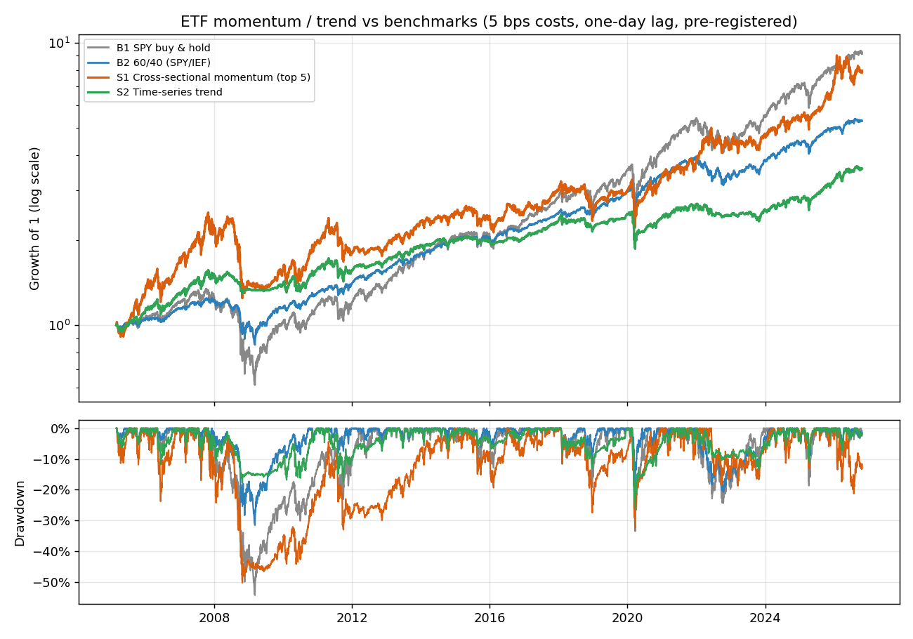

# ETF Momentum and Trend Study: Results

**Pre-registered.** Protocol committed before any ETF backtest (`c7bab14`, clarifications and code in `fe4f803`, 2026-10-24 20:08 local time).
The full protocol was run once, at 20:10 local time, under two minutes after the final commit. All 13 configurations and 3 benchmarks are reported below.
Parameters were taken from the literature and not tuned. See `research/etf_momentum_protocol.md` for exact definitions.

## Headline

**No evidence of alpha under the pre-registered criterion.** No configuration met all four checks. The strongest result
(S1_9m) had a full-period alpha of 3.4% against SPY and IEF with a Newey-West t-statistic of 1.08, against a required 2.0,
and its holdout alpha was only 0.5% (t = 0.12).
None of the four core strategies beat SPY or a 60/40 portfolio on Sharpe ratio, and the bootstrap confidence intervals of the differences include zero over the full period.

## Results (5 bps slippage, one-day execution lag, evaluation window 2005-02-28 to 2026-10-23)

| Strategy | Total return | CAGR | Sharpe (excess of RF) | Ann. vol | Max drawdown | Calmar | Corr. with SPY |
|---|---|---|---|---|---|---|---|
| S1 Cross-sectional momentum (top 5) | 697.1% | 10.1% | 0.49 | 20.3% | -50.3% | 0.20 | 0.66 |
| S2 Time-series trend | 258.5% | 6.1% | 0.46 | 10.5% | -26.3% | 0.23 | 0.76 |
| S3 Dual momentum | 663.9% | 9.9% | 0.48 | 20.3% | -50.3% | 0.20 | 0.66 |
| S4 Risk-managed dual momentum | 571.3% | 9.2% | 0.46 | 19.2% | -47.8% | 0.19 | 0.66 |
| B1 SPY buy & hold | 814.7% | 10.8% | 0.55 | 18.7% | -54.4% | 0.20 | 1.00 |
| B2 60/40 (SPY/IEF) | 428.9% | 8.0% | 0.63 | 10.4% | -31.6% | 0.25 | 0.97 |
| B3 Equal-weight ETF universe | 483.6% | 8.5% | 0.51 | 15.1% | -45.7% | 0.19 | 0.94 |

Design period (to 2016-12-31) and holdout (2017 onward):

| Strategy | design CAGR | design Sharpe | holdout CAGR | holdout Sharpe |
|---|---|---|---|---|
| S1 Cross-sectional momentum (top 5) | 8.0% | 0.43 | 12.6% | 0.57 |
| S2 Time-series trend | 6.1% | 0.51 | 6.0% | 0.39 |
| S3 Dual momentum | 7.7% | 0.41 | 12.6% | 0.57 |
| S4 Risk-managed dual momentum | 7.6% | 0.41 | 11.2% | 0.52 |
| B1 SPY buy & hold | 7.4% | 0.41 | 15.0% | 0.74 |
| B2 60/40 (SPY/IEF) | 6.9% | 0.58 | 9.4% | 0.69 |
| B3 Equal-weight ETF universe | 7.0% | 0.42 | 10.4% | 0.64 |

## Alpha tests

Annualised alpha from regressing daily excess returns on SPY and IEF excess returns (R2), Newey-West standard errors. Benchmarks should show roughly zero.

| Configuration | Alpha (full) | t (full) | Alpha (design) | Alpha (holdout) |
|---|---|---|---|---|
| S1_3m | 1.3% | 0.44 | 4.7% | -3.8% |
| S1_6m | -0.1% | -0.03 | -0.7% | -0.4% |
| S1_9m | 3.4% | 1.08 | 5.4% | 0.5% |
| S1_12m | 2.2% | 0.68 | 2.6% | 0.6% |
| S2_3m | 0.6% | 0.37 | 3.1% | -2.8% |
| S2_6m | 0.4% | 0.29 | 2.0% | -1.7% |
| S2_9m | 1.3% | 0.85 | 2.9% | -0.8% |
| S2_12m | 0.0% | 0.02 | 2.1% | -2.6% |
| S3_3m | 1.2% | 0.39 | 4.6% | -4.0% |
| S3_6m | -0.5% | -0.15 | -1.1% | -0.8% |
| S3_9m | 3.3% | 1.04 | 5.1% | 0.6% |
| S3_12m | 2.0% | 0.62 | 2.3% | 0.6% |
| S4_12m | 1.5% | 0.49 | 2.5% | -0.8% |
| B1 | -0.0% | -0.48 | -0.0% | -0.0% |
| B2 | -0.1% | -0.86 | -0.1% | -0.0% |
| B3 | -0.6% | -0.52 | -0.2% | -0.5% |

Bootstrap 95% confidence intervals of the Sharpe-ratio difference (stationary bootstrap, 10,000 resamples):

| Period: strategy | vs B1 SPY buy & hold | vs B2 60/40 (SPY/IEF) |
|---|---|---|
| full: S1 Cross-sectional momentum (top 5) | -0.06 [-0.39, +0.25] | -0.14 [-0.49, +0.20] |
| full: S2 Time-series trend | -0.10 [-0.36, +0.17] | -0.17 [-0.46, +0.12] |
| full: S3 Dual momentum | -0.07 [-0.40, +0.24] | -0.15 [-0.50, +0.19] |
| full: S4 Risk-managed dual momentum | -0.09 [-0.41, +0.22] | -0.17 [-0.51, +0.16] |
| holdout: S1 Cross-sectional momentum (top 5) | -0.17 [-0.69, +0.30] | -0.12 [-0.65, +0.43] |
| holdout: S2 Time-series trend | -0.35 [-0.65, -0.04] | -0.30 [-0.64, +0.09] |
| holdout: S3 Dual momentum | -0.17 [-0.69, +0.30] | -0.12 [-0.65, +0.43] |
| holdout: S4 Risk-managed dual momentum | -0.22 [-0.72, +0.23] | -0.17 [-0.68, +0.35] |

The only interval that excludes zero is the wrong way round: the time-series trend strategy (S2) was significantly worse than SPY in the holdout.

## Stress windows

| Strategy | 2008 (calendar yr) | COVID crash (Feb 19-Mar 23 2020) | 2022 (calendar yr) |
|---|---|---|---|
| S1 Cross-sectional momentum (top 5) | -35.5% | -32.4% | 15.6% |
| S2 Time-series trend | -10.7% | -26.3% | -8.7% |
| S3 Dual momentum | -37.7% | -32.4% | 15.6% |
| S4 Risk-managed dual momentum | -31.4% | -32.4% | 10.2% |
| B1 SPY buy & hold | -36.2% | -33.5% | -18.1% |
| B2 60/40 (SPY/IEF) | -17.3% | -18.3% | -16.3% |
| B3 Equal-weight ETF universe | -30.3% | -29.7% | -9.4% |

## Sensitivity to costs and execution timing

| Strategy / variant | CAGR | Sharpe | Max drawdown | R2 alpha (t) |
|---|---|---|---|---|
| S1 base (5bps, lag 1) | 10.1% | 0.49 | -50.3% | 2.2% (0.68) |
| S1 10bps | 9.7% | 0.47 | -50.4% | 1.8% (0.57) |
| S1 25bps | 8.7% | 0.43 | -50.7% | 0.9% (0.27) |
| S1 no lag | 9.2% | 0.45 | -46.1% | 1.5% (0.45) |
| S2 base (5bps, lag 1) | 6.1% | 0.46 | -26.3% | 0.0% (0.02) |
| S2 10bps | 6.0% | 0.44 | -26.3% | -0.1% (-0.07) |
| S2 25bps | 5.6% | 0.41 | -26.4% | -0.4% (-0.31) |
| S2 no lag | 6.4% | 0.48 | -26.0% | 0.4% (0.27) |
| S3 base (5bps, lag 1) | 9.9% | 0.48 | -50.3% | 2.0% (0.62) |
| S3 10bps | 9.5% | 0.47 | -50.4% | 1.7% (0.52) |
| S3 25bps | 8.4% | 0.42 | -50.7% | 0.7% (0.21) |
| S3 no lag | 9.0% | 0.44 | -46.1% | 1.3% (0.40) |
| S4 base (5bps, lag 1) | 9.2% | 0.46 | -47.8% | 1.5% (0.49) |
| S4 10bps | 8.8% | 0.44 | -47.9% | 1.1% (0.37) |
| S4 25bps | 7.6% | 0.38 | -48.3% | -0.0% (-0.01) |
| S4 no lag | 8.8% | 0.45 | -37.7% | 1.5% (0.47) |

## What the results say

1. **Cross-sectional momentum (S1, S3) is mostly market exposure at higher risk.** Its correlation with SPY is about 0.66 and its 2008 and COVID-crash losses are close to SPY's. It did well in 2022 (up while SPY fell), but a single good year does not make an edge, and its full-period alpha is statistically indistinguishable from zero.
2. **The trend filter (S2) behaved the way trend filters are supposed to: lower drawdowns, lower returns.** Maximum drawdown was -26.3% against -54.4% for SPY, and 2008 was -10.7% against -36.2%.
   But its Calmar ratio (0.23) is no better than a plain 60/40 (0.25), and its Sharpe is lower. The protection is real, but it can be had more cheaply.
3. **No diversification windfall.** Correlation with SPY is 0.66 to 0.76 for the momentum and trend strategies, higher in the holdout.
4. **Costs and timing matter more than the signal.** At 25 bps the remaining alpha disappears. Shifting execution by one day changes S4's maximum drawdown from -47.8% to -37.7%, so drawdown figures from monthly top-5 portfolios are noisy and should not be over-read.
5. **Comparison with the earlier single-stock work.** On the survivorship-biased 98-stock universe, a six-factor regression (market, size, value, profitability, investment, momentum) gave the plain equal-weight benchmark about 6% annual alpha (t above 3) and momentum 10% to 11%. On ETFs the equal-weight benchmark's alpha is -0.6% and the strategies' is about 2% and insignificant. The universes and periods differ, so this is suggestive and not proof, but it fits survivorship bias having inflated the stock results.

## Limitations and post-results notes

- **Check 3 of the criterion is not discriminating.** The deflated Sharpe ratio tests whether a Sharpe ratio exceeds the best of 13 noise trials. The 13 configurations have similar Sharpe ratios (0.35 to 0.56), so the noise threshold is only about 0.10 and almost any positive-Sharpe strategy, including SPY, would pass it. Checks 1, 2 and 4 (alpha against SPY and IEF) were the binding ones. I wrote the criterion this way and have not changed it after seeing results; a better design would test the Sharpe *difference* against a benchmark.
- **The ETF list was chosen today** from funds that are large and liquid today. This is much milder than single-stock survivorship but not zero.
- **Factor and risk-free data end 2026-08-31**, so regressions and Sharpe ratios exclude the last two months of prices; price-only figures include them.
- **One historical path.** The design and holdout split is a stability check, not an independent test, because no parameter was fitted.
- **Cash earns 0%** on the 2% buffer; SHY is the parking asset for unallocated weight. No taxes, no currency effects, no short selling, ETFs only.

## Conclusion

Under a protocol fixed in advance, simple momentum and trend strategies on liquid ETFs did not produce alpha after costs, and the trend filter's drawdown reduction is matched by a plain 60/40. This is a clean negative result, reported in full, which is the point of pre-registering it.

