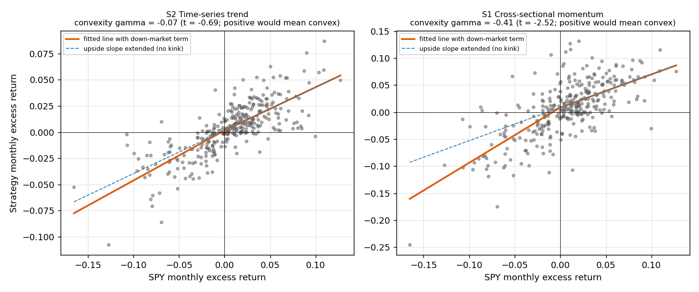

# Regime Study (v2): Results

**Pre-registered.** Protocol `research/regime_study_protocol.md` committed in `0e8cb32` (2026-10-24 23:20 local time) before any v2 test was run; the study was run once as written.
The runner code (`analysis/run_regime_study.py`, `strategies/etf_regime_benchmarks.py`) was written after the protocol commit and committed after the run, unlike the v1 study where code was committed first; it has not been modified since the run.
Pipeline checks passed on the real data before results were used: the saved v1 equity curves were reproduced exactly by the current code, and the month and bear-month counts matched the numbers fixed in the protocol (260/33 and 59/30).

## Question

Historically, did the trend and momentum strategies from the v1 ETF study behave differently when the market was in a bear regime
(SPY at least 10% below its peak with a negative trailing 12-month return, known at the prior month-end), and is the difference reliable?
This describes how the strategies behaved in past regimes. It does not forecast recessions or future returns.

## Headline

**Neither pre-registered hypothesis is confirmed, and the point estimates point the opposite way.**
The time-series trend strategy (S2) did not show convex payoffs against SPY (H1) and did not do better relative to a 60/40 stock/cash portfolio in bear months than in other months (H2).
The idea "when the market is down, this algorithm works" is not supported by the data.
Because the confirmatory sample contains one bear market (the dot-com bust), "not confirmed" here means "not established", and I cannot rule out smaller effects.

## Pre-registered decision

| hypothesis | confirmatory estimate | confirmatory p | exploratory estimate | pooled estimate | CONFIRMED |
|---|---|---|---|---|---|
| H1 convexity (g>0) | -0.0818 | 0.731 | -0.0717 | -0.0662 | not established |
| H2 bear outperformance (D>0) | -0.0049 | 0.882 | -0.0025 | -0.0016 | not established |

Rule: confirmed only if the confirmatory one-sided p <= 0.025 (Bonferroni for two tests) and the exploratory estimate has the same sign.

## H1: convexity (g > 0 predicted)

Monthly excess returns regressed on SPY and a down-market term: r_strategy = a + b * r_SPY + g * max(-r_SPY, 0). Newey-West standard errors, normal approximation for p.

| Strategy: sample | gamma (convexity) | beta | t(gamma) | one-sided p (gamma>0) |
|---|---|---|---|---|
| S2 Time-series trend: Confirmatory 2000-2004 (59 mo) | -0.08 | 0.33 | -0.61 | 0.731 |
| S2 Time-series trend: Exploratory 2005-2026 (260 mo) | -0.07 | 0.43 | -0.61 | 0.728 |
| S2 Time-series trend: Pooled (319 mo) | -0.07 | 0.41 | -0.69 | 0.756 |

For S2 the estimate is slightly negative in both samples, with t about -0.6. Secondary strategies:

| Strategy: sample | gamma (convexity) | beta | t(gamma) | one-sided p (gamma>0) |
|---|---|---|---|---|
| S1 Cross-sectional momentum: Confirmatory 2000-2004 (59 mo) | -0.37 | 0.73 | -1.86 | 0.969 |
| S1 Cross-sectional momentum: Exploratory 2005-2026 (260 mo) | -0.41 | 0.59 | -2.05 | 0.980 |
| S1 Cross-sectional momentum: Pooled (319 mo) | -0.41 | 0.62 | -2.52 | 0.994 |
| S3 Dual momentum: Confirmatory 2000-2004 (59 mo) | -0.41 | 0.57 | -1.92 | 0.973 |
| S3 Dual momentum: Exploratory 2005-2026 (260 mo) | -0.40 | 0.59 | -2.03 | 0.979 |
| S3 Dual momentum: Pooled (319 mo) | -0.40 | 0.59 | -2.47 | 0.993 |
| S4 Risk-managed dual momentum: Confirmatory 2000-2004 (59 mo) | -0.37 | 0.55 | -1.83 | 0.966 |
| S4 Risk-managed dual momentum: Exploratory 2005-2026 (260 mo) | -0.39 | 0.55 | -2.12 | 0.983 |
| S4 Risk-managed dual momentum: Pooled (319 mo) | -0.39 | 0.55 | -2.54 | 0.994 |

## H2: bear-regime outperformance vs 60/40 cash

D = mean(active return | bear) - mean(active return | other months), active = strategy minus (60% SPY, 40% cash). Stationary bootstrap, mean block 12 months, 10,000 resamples.

| Strategy: sample | D (bear minus other) | 95% interval | one-sided p (D>0) | bear months |
|---|---|---|---|---|
| S2 Time-series trend: Confirmatory 2000-2004 (59 mo) | -0.49% | [-1.52%, 0.32%] | 0.882 | 30 |
| S2 Time-series trend: Exploratory 2005-2026 (260 mo) | -0.25% | [-1.37%, 0.64%] | 0.768 | 33 |
| S2 Time-series trend: Pooled (319 mo) | -0.16% | [-0.84%, 0.35%] | 0.750 | 63 |

Secondary strategies:

| Strategy: sample | D (bear minus other) | 95% interval | one-sided p (D>0) | bear months |
|---|---|---|---|---|
| S1 Cross-sectional momentum: Confirmatory 2000-2004 (59 mo) | -0.39% | [-1.92%, 1.57%] | 0.685 | 30 |
| S1 Cross-sectional momentum: Exploratory 2005-2026 (260 mo) | -1.36% | [-2.65%, 0.82%] | 0.927 | 33 |
| S1 Cross-sectional momentum: Pooled (319 mo) | -0.94% | [-1.98%, 0.14%] | 0.957 | 63 |
| S3 Dual momentum: Confirmatory 2000-2004 (59 mo) | -0.68% | [-2.22%, 1.31%] | 0.786 | 30 |
| S3 Dual momentum: Exploratory 2005-2026 (260 mo) | -1.49% | [-2.82%, 0.78%] | 0.934 | 33 |
| S3 Dual momentum: Pooled (319 mo) | -1.14% | [-2.17%, -0.05%] | 0.979 | 63 |
| S4 Risk-managed dual momentum: Confirmatory 2000-2004 (59 mo) | -0.79% | [-2.19%, 0.97%] | 0.839 | 30 |
| S4 Risk-managed dual momentum: Exploratory 2005-2026 (260 mo) | -1.26% | [-2.45%, 0.56%] | 0.940 | 33 |
| S4 Risk-managed dual momentum: Pooled (319 mo) | -1.02% | [-1.88%, -0.08%] | 0.982 | 63 |

## H3 (exploratory only): rising-rate regime

IEF's trailing 12-month return negative at the prior month-end (80 of 260 months), active return vs a 60/40 SPY/IEF portfolio.

| Strategy: sample | D (bear minus other) | 95% interval | one-sided p (D>0) | bear months |
|---|---|---|---|---|
| S2 Time-series trend: Exploratory 2005-2026 (260 mo) | -0.13% | [-0.65%, 0.35%] | 0.684 | 80 |
| S1 Cross-sectional momentum: Exploratory 2005-2026 (260 mo) | -0.27% | [-1.53%, 0.86%] | 0.684 | 80 |

No evidence of a rising-rate advantage for either strategy.

## Descriptive context (not tests)

| Sample, series, regime | n | mean/mo | vol/mo | worst month |
|---|---|---|---|---|
| conf. S2 trend BEAR | 30 | -0.23% | 1.43% | -3.24% |
| conf. S2 trend other | 29 | 0.86% | 3.01% | -5.62% |
| conf. SPY BEAR | 30 | -0.53% | 5.33% | -10.18% |
| conf. SPY other | 29 | 0.49% | 3.70% | -7.32% |
| conf. 60/40 cash BEAR | 30 | -0.23% | 3.21% | -6.17% |
| conf. 60/40 cash other | 29 | 0.37% | 2.20% | -4.20% |
| expl. S2 trend BEAR | 33 | 0.04% | 2.09% | -5.23% |
| expl. S2 trend other | 227 | 0.59% | 2.61% | -10.55% |
| expl. SPY BEAR | 33 | 0.44% | 6.93% | -16.20% |
| expl. SPY other | 227 | 1.02% | 3.69% | -12.41% |
| expl. 60/40 cash BEAR | 33 | 0.37% | 4.19% | -9.29% |
| expl. 60/40 cash other | 227 | 0.67% | 2.17% | -6.78% |

Over the confirmatory window (Feb 2000 to Dec 2004) the cumulative return of S2 was +17.8% against -7.5% for SPY and +1.6% for 60/40 cash.
Inside the bear months only, S2 returned -7.0% against -18.1% for SPY and -8.1% for 60/40 cash; in the other months S2 returned +26.7% against +12.9% and +10.6%.
So S2 limited losses relative to SPY during the dot-com bust but did about as well as a plain 60/40 cash portfolio there; its edge in this window came from the months outside the bear regime. This was not a pre-registered test and rests on one episode.

## What the results say

1. **S2 was defensive, not convex.** Its monthly volatility in bear months was 1.43% (confirmatory) and 2.09% (exploratory), against 5.33% and 6.93% for SPY, and its worst bear-month loss was far smaller (-3.24% and -5.23% against -10.18% and -16.20% for SPY). Relative to a 60/40 cash portfolio it was about the same in the confirmatory bear months and worse in the exploratory ones.
2. **A plausible but untested explanation:** a monthly rebalance on a 12-1 month signal reacts slowly, so it may exit only after much of a fast decline has happened, which would fit the absence of convexity. I did not test this.
3. **Post-results observation (not pre-registered): the cross-sectional momentum strategies look anti-convex.** For S1, S3 and S4 the down-market coefficient is about -0.4 in every sample (pooled t = -2.52 for S1), i.e. they lose more per unit of market decline when the market is falling than they gain when it rises. In the pooled sample their active return in bear months is also lower than in other months (S3 D = -1.14% with a 95% interval of [-2.17%, -0.05%], S4 D = -1.02% with [-1.88%, -0.08%]). This is consistent with the "momentum crash" literature (Daniel and Moskowitz, 2016). The study reports 12 H1 and 12 H2 strategy-sample combinations in total, so treat it as a hypothesis for a future pre-registered study, not a finding. Post-hoc robustness check: excluding October 2008 (S1 lost 24.6% when SPY fell 16.5%) moves S1's coefficient from -0.41 (t = -2.54; this check uses the 316 months with complete data, hence the small difference from the table above) to -0.31 (t = -1.95), and excluding the three worst SPY months gives -0.39 (t = -2.24). The sign is stable, but the significance is borderline and leans on a few crisis months.

## Limitations

- **One bear market in the confirmatory sample.** A non-significant confirmatory result is inconclusive. Across both samples there are about 4 to 5 independent bear episodes.
- **The exploratory sample was already seen** in the v1 study and partly motivated the hypotheses, so it cannot confirm anything.
- **The regime definition** (SPY drawdown plus negative 12-month return) was chosen after counting SPY-only flagged months, never strategy returns, but it remains one of several reasonable definitions.
- **Early country ETFs trade thinly** (8% to 15% of days with an unchanged close), the confirmatory universe has no bonds before mid-2002 and no commodities or REITs, and cash before 2002 is a T-bill index built from Ken French's risk-free rate.
- **p-values for H1 use a normal approximation** with 59 and 258 monthly observations; H2 uses a bootstrap p-value from the resampled estimator.
- **Macro data** (inflation, unemployment, growth) was deliberately not used; it needs point-in-time vintages and is deferred.

## Conclusion

Under a protocol fixed in advance, trend and momentum on liquid ETFs did not provide a measurable advantage in bear regimes. The trend strategy reduced volatility and tail losses without outperforming a simple 60/40 cash portfolio inside bear months, and the momentum strategies appear to do relatively worse in bear regimes. This is a second negative result, and the momentum-crash pattern is a candidate hypothesis for follow-up.

